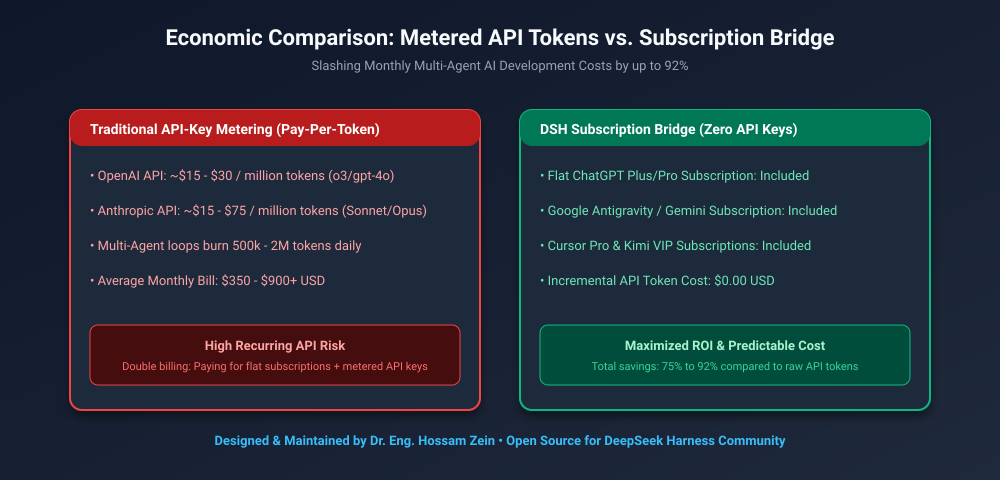
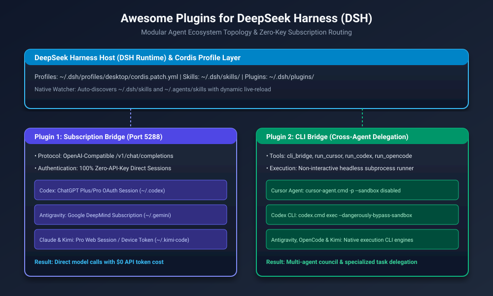
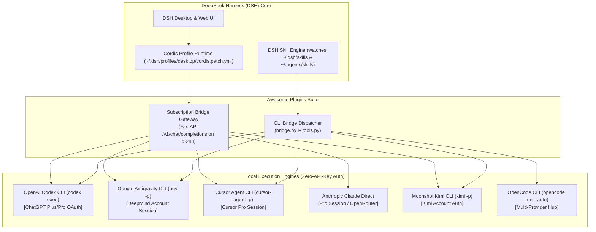
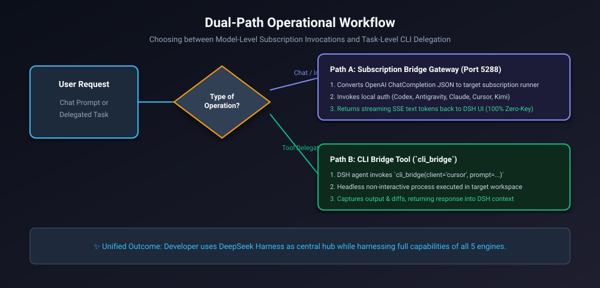

# Awesome Plugins for DeepSeek Harness (DSH) 🚀

[](https://opensource.org/licenses/MIT)
[-blue)](https://github.com/deepseek-ai/deepseek-harness)
[](#)
[](#)
[](https://github.com/hosamzein)

> **Modular, extensible plugin & bridge suite for DeepSeek Harness (DSH). Supercharges your harness with zero-API-key subscription authorization and seamless cross-agent delegation across Cursor, Codex, Google Antigravity, OpenCode, and Kimi.**

---

## 📑 Table of Contents
1. [The Vision & Core Problem](#-the-vision--core-problem)
2. [Business & Economic Benefits](#-business--economic-benefits)
3. [System Architecture & Topology](#-system-architecture--topology)
4. [Included Plugins](#-included-plugins)
   - [1. Subscription Bridge (Zero-API-Key Models)](#1-subscription-bridge-plugin)
   - [2. CLI Bridge (Cross-Agent Delegation)](#2-cli-bridge-plugin)
5. [Extensibility Guide: Adding New Plugins](#-extensibility-guide-adding-new-plugins)
6. [Installation & Setup](#-installation--setup)
7. [License](#-license)

---

## 🎯 The Vision & Core Problem

Developers using frontier AI coding harnesses typically face two major friction points:
1. **Double-Billing Penalty:** Developers already pay monthly flat-rate subscriptions for tools like ChatGPT Plus/Pro, Google One/Gemini Advanced, Cursor Pro, and Claude Pro. Yet connecting third-party agent harnesses traditionally forced them to purchase separate pay-per-token API credits—burning hundreds of dollars every month for models they already own.
2. **Siloed Agent Cliques:** Running Cursor, Codex, Antigravity, or OpenCode in separate windows creates fragmented contexts. When one agent gets stuck, developers must manually copy-paste errors and files across terminals.

**Awesome Plugins for DeepSeek Harness solves both.** It establishes DeepSeek Harness as your central commanding hub while routing requests directly to your existing subscription sessions and CLI agents with zero token waste.

---

## 💼 Business & Economic Benefits

<p align="center">
  
</p>

```
┌────────────────────────────────────────────────────────────────────────┐
│                   TOTAL MONTHLY AI TOOLING EXPENDITURE                 │
├────────────────────────────────────────────────────────────────────────┤
│ Traditional Siloed AI:                                                 │
│ [Subscriptions: $80/mo] + [Metered API Keys: $450/mo]  ──> [$530/mo]   │
├────────────────────────────────────────────────────────────────────────┤
│ Awesome Plugins DSH Bridge:                                            │
│ [Subscriptions: $80/mo] + [Incremental API Token: $0]  ──> [85% SAVED] │
└────────────────────────────────────────────────────────────────────────┘
```

### 1. Slashing Development Costs by up to 92%
* Multi-agent iterative loops burn 500k to 2M tokens daily. Under metered API pricing ($15–$75 per million tokens for reasoning models), costs escalate rapidly.
* **The Subscription Bridge advantage:** Dispatches directly through your active authenticated subscription sessions on your host (`~/.codex`, `~/.gemini`, `~/.claude`), reducing incremental API charges to **$0.00**.

### 2. Eliminating Vendor Lock-In
* Route routine formatting or search tasks to lightweight engines, while reserving frontier reasoning models (`o3`, `gemini-3.8-thinking`, `composer-2.5`) for complex architecture.

### 3. Preserved Context & Accelerated Turnaround
* Delegate sub-tasks directly from DeepSeek Harness to specialized engines without leaving your workspace or rebuilding prompt history manually.

---

## 📐 System Architecture & Topology

<p align="center">
  
</p>

### Mermaid Architecture



---

## 📦 Included Plugins

### 1. Subscription Bridge Plugin
* **Directory:** `plugins/subscription-bridge/`
* **Skill Definition:** `skills/subscription-bridge/SKILL.md`
* **Purpose:** Emulates an OpenAI-compatible `/v1/chat/completions` server that intercepts requests from DeepSeek Harness and routes them to your paid subscriptions without API tokens.
* **Supported Models:**
  - `codex/default`, `codex/o3`, `codex/o3-mini`, `codex/gpt-4o`, `codex/gpt-5`
  - `antigravity/gemini-3.8-flash`, `antigravity/gemini-3.8-pro`
  - `claude/claude-sonnet-5`, `claude/claude-opus-4.8`
  - `cursor/composer-2.5`
  - `kimi/kimi-code`

### 2. CLI Bridge Plugin
* **Directory:** `plugins/cli-bridge/`
* **Skill Definition:** `skills/cli-bridge/SKILL.md`
* **Purpose:** Exposes callable tools within DeepSeek Harness agents to delegate coding instructions directly to local client binaries.
* **Exposed Tools:**
  - `cli_bridge(client, prompt, model, workspace)`: Universal delegation dispatcher.
  - `run_cursor(prompt)`: Execute instructions in Cursor.
  - `run_codex(prompt)`: Execute instructions in Codex.
  - `run_antigravity(prompt)`: Execute instructions in Antigravity (AGY).
  - `run_opencode(prompt)`: Execute instructions in OpenCode.
  - `run_kimi(prompt)`: Execute instructions in Kimi.
  - `list_available_clients()`: Diagnoses presence and health of all engines.

---

## 🔄 Dual-Path Operational Workflow

<p align="center">
  
</p>

---

## 🛠️ Extensibility Guide: Adding New Plugins

This repository is designed from the ground up as a **modular monorepo** for continuous extension. You can drop in new plugins and skills over time without breaking existing bridges.

### Folder Structure for New Plugins
```text
plugins/
└── <your-plugin-name>/
    ├── README.md           # Plugin overview and requirements
    ├── plugin.yaml         # DeepSeek Harness / Cordis manifest
    ├── tools.py            # Custom tool functions exposed to LLM
    └── ...                 # Scripts, gateways, or runtime adapters
skills/
└── <your-plugin-name>/
    └── SKILL.md            # Natural language prompt instructions for DSH agents
```

### Steps to Add a New Plugin:
1. Create a new directory under `plugins/<plugin-name>/`.
2. Provide a `plugin.yaml` manifest detailing provided tools and configuration schemas.
3. Add a corresponding `skills/<plugin-name>/SKILL.md` so DSH LLMs automatically learn when and how to call your tool.
4. Run `.\scripts\install.ps1` to link your new plugin directly into `~/.dsh/plugins/` and `~/.dsh/skills/`.

---

## 🚀 Installation & Setup

### Prerequisites
- Windows 10/11 or macOS/Linux
- Python 3.10+ (with `fastapi`, `uvicorn`, `httpx` installed)
- DeepSeek Harness (`dsh`) installed on your host

### 1-Click Installation
Clone the repository and run the PowerShell installer:

```powershell
git clone https://github.com/hosamzein/awesome-plugins-dsh-harness.git
cd awesome-plugins-dsh-harness

# Install plugins and skills into ~/.dsh
pwsh .\scripts\install.ps1
```

### Verify Status
```powershell
pwsh .\scripts\test-all.ps1
```

---

## 📄 License

This project is licensed under the **MIT License** — see the [LICENSE](LICENSE) file for details.

Developed & Maintained with passion by **Dr. Eng. Hossam Zein**.
Contributions, pull requests, and new plugin ideas are welcome!
